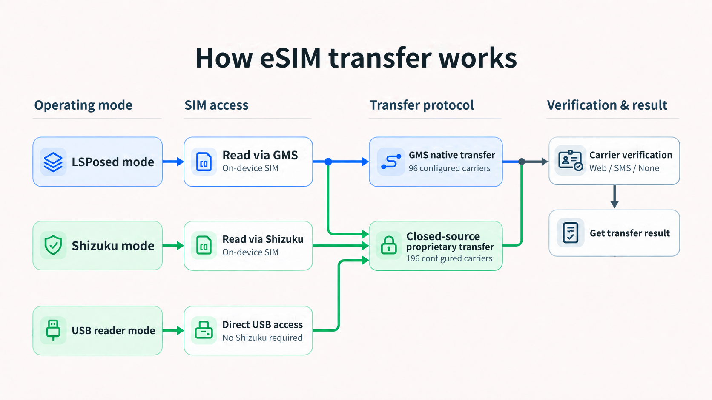

# eSIM transfer

Android application for transferring a SIM from the current Android device through Google Play services and inspecting SIM cards in USB readers.

[Downloads](https://github.com/lilyzhaun/esim-transfer/releases) · [简体中文](README.zh-CN.md)

## How it works

This diagram shows the transfer paths in the official signed APK. Builds from this repository use Google Play services for transfers and the USB reader for read-only diagnostics.



## Use

Enable the module in LSPosed, select Google Play services in its scope, and reload Google Play services. Open the app and connect the service. Select the source SIM, enter the target EID and IMEI and any carrier-required fields, then complete the system's source-device verification. Use the result on the target device.

The interface uses miuix and provides configurable appearance, floating navigation, saved targets, and persistent transfer history. Download information does not by itself confirm installation on the target device. Availability depends on the carrier, account, and devices.

Transfer history, carrier web verification, and task-log export are available in the app. Carrier and Google Play services compatibility can change.

### USB reader

On an Android device with USB host (OTG) support, plug in one single-slot CCID reader and insert a SIM. Open **USB reader** from the Transfer tab, tap **Read reader**, and approve the Android USB prompt when asked. See [简体中文](README.zh-CN.md) for the exact labels. Short APDUs and T=0 TPDU are supported. The app displays the ICCID suffix and operator information from the card. This path works offline without LSPosed, sends no authentication or write commands to the SIM, and cannot submit a transfer from the reader.

Open **Reader logs** to view the current attempt or a past one and export the raw log. Logs stay in app-private storage unless you export them. Detailed exports can contain full ICCIDs, IMSIs, and card responses; do not share them publicly.

The application UI remains in Simplified Chinese. English repository documentation and build messages do not change the application's language.

## Source and licensing

Files in this repository are licensed under Apache-2.0 unless otherwise noted. Bundled components retain their respective terms; see `NOTICE.md` and the in-app license notices.

## Building

Clone this repository. Install JDK 21, Android SDK Platform 37, and Build Tools 36.0.0. Set `ANDROID_HOME` or configure `sdk.dir` in `local.properties`. The Gradle wrapper resolves dependencies from Google Maven and Maven Central.

```sh
./gradlew :app:assembleDebug
./gradlew :app:assembleRelease
```

APKs are written to `app/build/outputs/apk/`. Debug builds are signed with your local debug key; release builds require your own signing key to install. A locally signed APK cannot update an installation signed with a different key.
